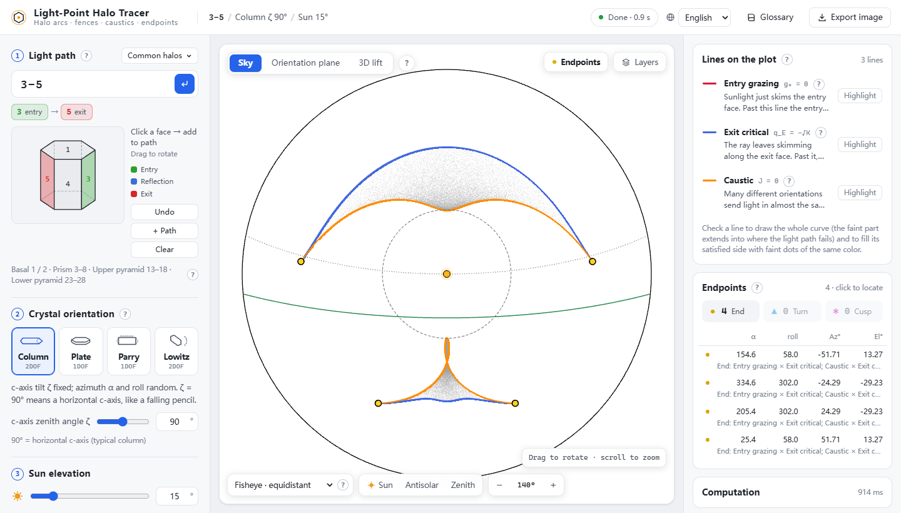
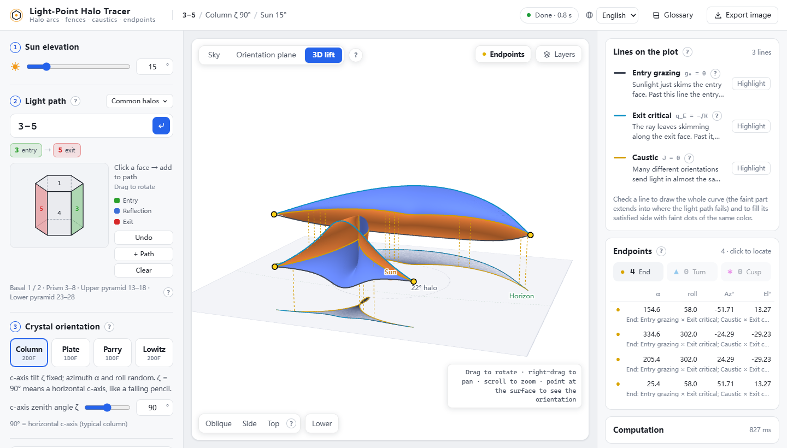

# Light-Point Halo Tracer

**English** · [中文](README.zh-CN.md)

Type a light path through a hexagonal ice crystal, for example `3-1-5`. The tracer shows where that path puts a halo arc in the sky. It also computes the arc's exact boundaries, its brightest edge and the points where it ends. Everything is solved in closed form or by root-finding; nothing is estimated from ray-tracing samples.

**Try it online: <https://galliumboride.github.io/Light-Point-Trace/>**

The whole tool is one HTML file. You can also download [`dist/LightPointTrace.html`](dist/LightPointTrace.html) and double-click it. It runs offline in any modern browser on Windows, macOS, Linux or a tablet.




## What it shows

- **Arcs in the sky.** The tool samples random crystal orientations (Monte Carlo) to show where the light can go. On top of that cloud it draws the exact edges:
  - **Fences**: one validity condition is exactly critical, for example the sun grazing the entry face.
  - **The caustic**: many orientations pile their light onto the same direction, which gives the bright rim you see in photos.
- **Endpoints.** These are where an arc really ends (●), folds back (▲), forms a cusp in the sky (✱), crosses a blue edge (×) or is cut off by a finite crystal (◆). Each one comes from a closed-form intersection: a quartic in one variable.
- **Orientation plane.** This is the same information drawn as a map of crystal orientations. Click any point and the panel lists, step by step, which condition fails for that orientation.
- **3D lift.** The valid region of the orientation plane is lifted above the sky. Each orientation sits directly above the point where it sends the light, and its height is the second orientation angle. The surface stands vertical and folds back at the caustic; its shadow on the ground is the arc. This works for any path. One-angle modes (plate, Parry) give a lifted curve instead of a surface.
- **Mirror fill-in.** Mirroring the sky left to right brings in the orientations and light path that produce the mirror half. These are drawn in the orientation plane too, for example 3-1-5 ↔ 3-2-5.

You can choose:
- **Orientation**: column crystals (fixed c-axis tilt), plates, Parry, Lowitz.
- **Sun elevation.**
- **Partial reflection.**
- **Pyramid faces**: by apex angle or Miller index.
- **Real crystal size**: finite prism, aperture fences.
- **Sky projection**: six choices.

A built-in glossary explains every term in plain language first, symbols last. The interface is available in Chinese and English.

## How it works

The method is called the *light-point method*. A ray direction is drawn as a point on a sphere: radius 1 in air, radius n = 1.31 in ice.
- **Refraction** moves the point along the face normal from one sphere to the other.
- **Internal reflection** mirrors the point in the face.

A light path is then just a short chain of translations and mirror images. Whether it works for a given orientation comes down to the signs of a few scalars: g₀, q_k and q_E. The arc's boundaries are where those scalars reach their critical values, so they can be traced exactly. The caustic is the fold line of the map from orientation to sky direction, where the Jacobian J = (∂ᵤD × ∂ᵥD)·D is zero.

Some paths, such as column 3-5-6-8, squash every valid orientation onto one line in the sky (J ≡ 0). The tool detects this and does not trace a caustic, which would only be rounding noise.

The engine (`src/engine/`) is a line-by-line JavaScript port of the author's C# engine. It was cross-checked on 14 test cases covering:
- column and Lowitz orientations;
- partial reflection;
- pyramid paths;
- multiple paths at once;
- real-crystal apertures.

The orientation-plane grids match exactly. Roots, endpoints and connected lines agree to about 1e-13. The Monte Carlo clouds match point for point, because the .NET random generator was ported too.

## Build from source

```bash
npm install
```

```bash
npm run build
```

This writes `dist/LightPointTrace.html`, a single file with the CSS, JavaScript, Web Worker and three.js inlined, and a copy at `docs/index.html` for GitHub Pages. `npm run watch` rebuilds on every change, and `npm run serve` starts a local preview at <http://127.0.0.1:5178>.

```
src/engine/   light-point engine: chains, Jacobian, families, orientation plane, sky tracing, endpoints,
              aperture (real crystal), 3D lift mesh (lift.js), mirror paths (mirror.js), J ≡ 0 detection (collapse.js)
src/worker.js computation worker (each path runs in two workers in parallel: sky, and orientation plane → endpoints → lines)
src/app/      interface: main.js, render.js (sky / orientation plane), view3d.js (3D lift, three.js),
              terms.js + glossary.js, i18n.js + locales/ (zh-CN source, en)
tools/        serve.mjs (local preview), check-locales.mjs (checks every locale against zh-CN)
```

To add a language, copy `src/app/locales/zh-CN.js`, translate it and register it in `src/app/i18n.js`. Then run `npm run check-locales`; it checks keys, `{placeholders}`, HTML tags and array lengths.

## License

[MIT](LICENSE)
