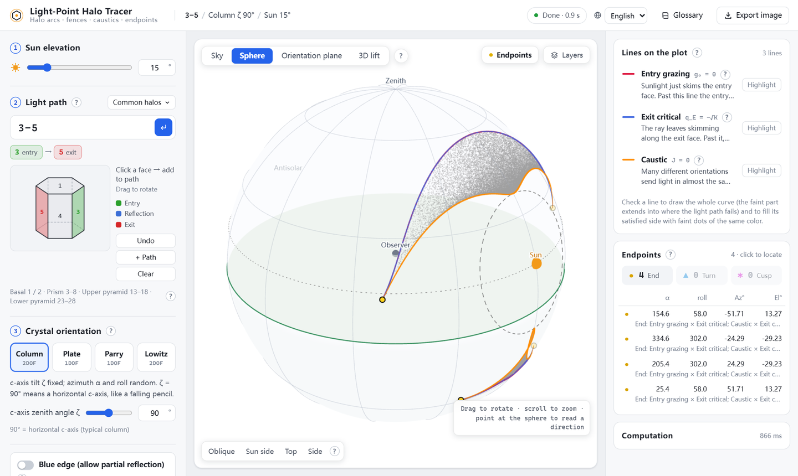

# 光点法边界追踪

[English](README.md) · **中文**

输入一条光在六棱冰晶里走的路线 (面号串, 如 `3-1-5`), 看它在天上画出什么弧, 以及弧的精确边界、最亮的边 (焦散) 和弧在哪里结束 (末端点). 边界和末端点都是闭式或求根得到的, 不是从光线追踪的采样里估出来的.

**在线使用: <https://galliumboride.github.io/Light-Point-Trace/>**

整个工具就是一个 HTML 文件: 也可以下载 [`dist/LightPointTrace.html`](dist/LightPointTrace.html) 双击打开, 离线可用, Windows / macOS / Linux / 平板的现代浏览器都行.





## 能看什么

- **天空里的弧**: 随机姿态的 MC 点云铺出弧的范围, 上面画精确的边 — 边界 (某个有效条件恰好处在临界, 如阳光恰好掠过入射面) 和焦散 (很多姿态把光送到同一方向, 照片里那条亮缘).
- **末端点**: 弧真正结束 (●)、折回 (▲)、在天上打尖 (✱)、穿过蓝边 (×)、被有限大小的晶体剪断 (◆) 的地方; 每个都是闭式交点 (一元四次方程).
- **天球**: 站在球外旁观整个天球 — 观察者在球心, 地平面把球切成两半, 太阳、点云、线和末端点都画在球面上, 拖动绕着看, 弧的真实形状和它与太阳、地平线的位置关系一目了然.
- **取向平面**: 同一件事画在"晶体姿态地图"上. 单击任一点, 右栏逐条说明这个姿态下光路卡在哪一步. 两个角都首尾相接, 所以也可以切到「环面」把地图卷成甜甜圈: 绕大圈一周是 α, 绕管子一周是 roll 或 ζ, 平面图边上断开的曲线在环面上接成一整条. Lowitz 的 ζ 只取 0–180° 时只画半根管子.
- **3D 抬升**: 把取向平面上成立的那一块抬到天空上方 — 每个姿态放在它把光送去的天空位置正上方, 高度是第二个取向角. 高度零点可选折痕、本块平均, 或归一化的「距折痕」: 高度 = 取向平面上到最近折痕的距离, 紫面在上, 折痕永远水平 (Lowitz 的 ζ 沿弧从 0 爬到 180°, 用它更直观). 曲面在焦散处竖直立起、折回去, 地面上的影子就是弧. 任何光路都能看; 板晶、Parry 只有一个随机角, 抬起来是空间曲线. 地面可选平面鱼眼图或天球本身 (曲面沿径向抬离球面).
- **等光强线** (图层里打开): 天空上光强相等的点连成的线, 线上标数值 (每颗晶体每球面度的份额). 光强 = 落到同一点的全部姿态之和 Σ w/|J| / 4π², J 是光点法雅可比, 权重 w 可选「投影面积 × Fresnel」(入射面迎光面积乘各界面的透过/反射率, 全由法向动量算出) 或只算几何密度. 不撒随机晶体、不数像素: 沿「光强 = 某值」逐点追出曲线; 越过焦散光强跳变, 线在焦散上终止. 柱晶棱柱楔等光路几秒内出来, Lowitz 3-5、锥晶要做一维求解, 十几秒. 只对二自由度取向 (柱晶、Lowitz).
- **左右镜像补全**: 天上左右镜像过去的那一半来自哪些姿态、哪条光路 (如 3-1-5 ↔ 3-2-5), 也画进取向平面.

可选: 太阳高度 (−90°–90°)、折射率 (默认 1.31)、晶体取向 (柱晶 ζ 固定、板晶、Parry、Lowitz; Lowitz 的 ζ 可以转满一圈 0–360° 或只转半圈 0–180°, 半圈时区域在晶体放平处截断, 截断边单独画出并算末端点)、蓝边 (允许部分反射)、锥面 (顶角或 Miller 指数; 晶体图可切换成锥晶, 直接点锥面 13–18 / 23–28 加入光路)、真实晶体尺寸 (有限六棱柱, 孔径边界)、天空相机 (六种投影, 视线方向和视场可在左栏输入). 内置术语表, 每个词先用大白话说它管什么事, 符号放最后. 界面有中文和英文.

## 原理

**光点法**: 把光线方向画成球面上的一个点 — 空气里在半径 1 的球上, 冰里在半径 n (默认 1.31) 的球上. 折射 = 光点沿晶面法线在两个球之间平移; 晶体内反射 = 光点对这个面做镜像. 一条光路就是一小串平移和镜像; 某个姿态下光路成不成立, 只看几个数的正负 (g₀、q_k、q_E). 弧的边界就是这些数恰好到临界值的地方, 因此可以精确追踪. 焦散是"姿态 → 出射方向"这个映射的折叠线, 即雅可比 J = (∂ᵤD × ∂ᵥD)·D = 0.

有些光路 (如柱晶 3-5-6-8) 把所有成立的姿态压成天上的一条线 (J ≡ 0), 这时没有焦散; 程序会识别出来, 不去追踪舍入噪声.

计算引擎 (`src/engine/`) 是作者 C# 引擎的逐句 JavaScript 移植, 用 14 个用例与 C# 逐点对账 (柱晶、Lowitz、部分反射、锥面光路、多条光路、真实晶体孔径): 取向平面网格完全相同, 根点、末端点、连线偏差约 1e-13, MC 点云逐点一致 (.NET 随机数发生器也移植了).

## 从源码构建

```bash
npm install
```

```bash
npm run build
```

生成 `dist/LightPointTrace.html` (单文件, CSS / JS / Web Worker / three.js 全部内联), 并复制一份到 `docs/index.html` 供 GitHub Pages 发布. `npm run watch` 改动后自动重建; `npm run serve` 在 <http://127.0.0.1:5178> 本地预览.

```
src/engine/   光点法引擎: 链、雅可比、各族、取向平面、天空追踪、末端点、孔径 (真实晶体)、
              3D 抬升网格 (lift.js)、镜像光路 (mirror.js)、J ≡ 0 判断 (collapse.js)
src/worker.js 计算 Worker (每条光路两个 Worker 并行: 天空 ‖ 取向平面 → 末端点 → 连线)
src/app/      界面: main.js、render.js (天空 / 取向平面)、view3d.js (3D 抬升, three.js)、
              sphere3d.js (天球)、torus3d.js (取向平面卷成环面)、terms.js + glossary.js (术语表)、i18n.js + locales/ (zh-CN 原文, en)
tools/        serve.mjs (本地预览)、check-locales.mjs (各语言与 zh-CN 结构一致性检查)
```

添加一种语言: 复制 `src/app/locales/zh-CN.js` 翻译, 在 `src/app/i18n.js` 里登记, 然后 `npm run check-locales` (检查键、`{变量}`、HTML 标签、数组长度).

## 许可证

[MIT](LICENSE)
